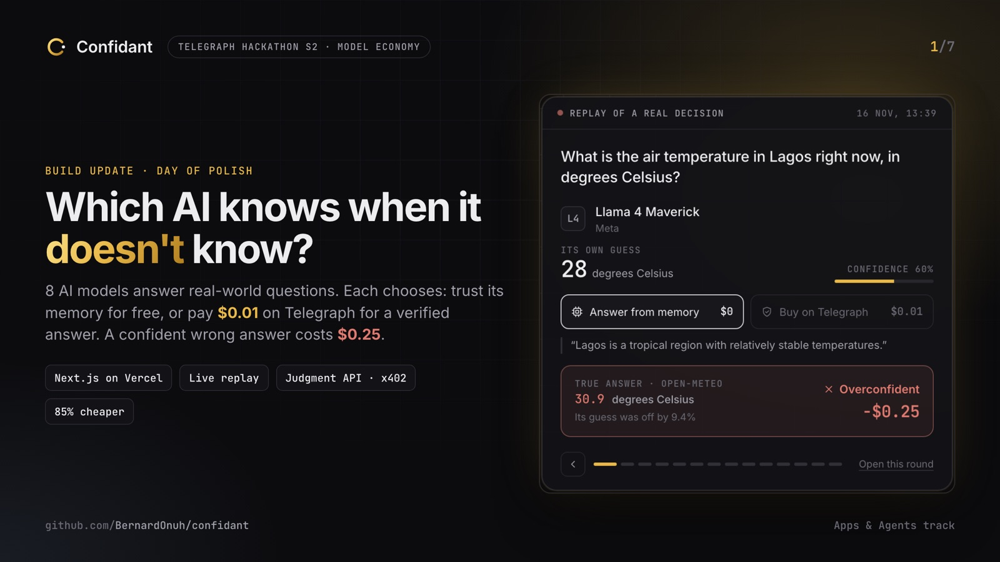
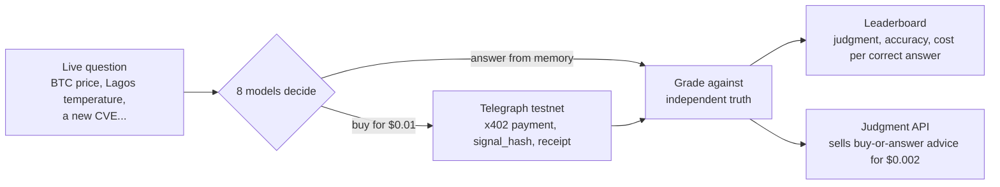
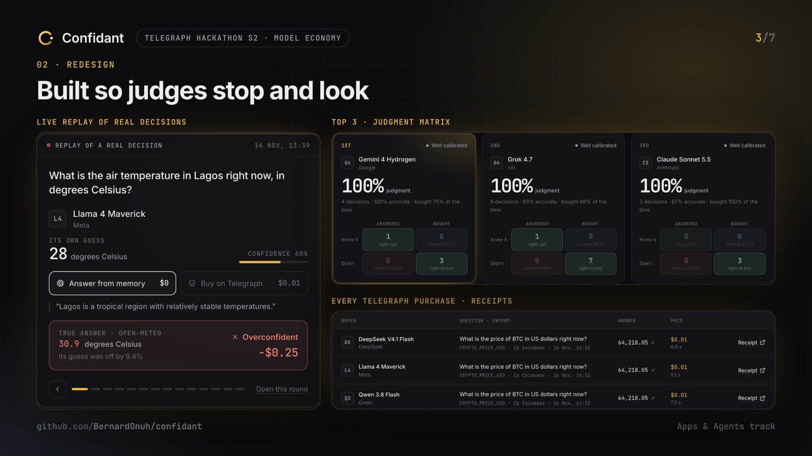
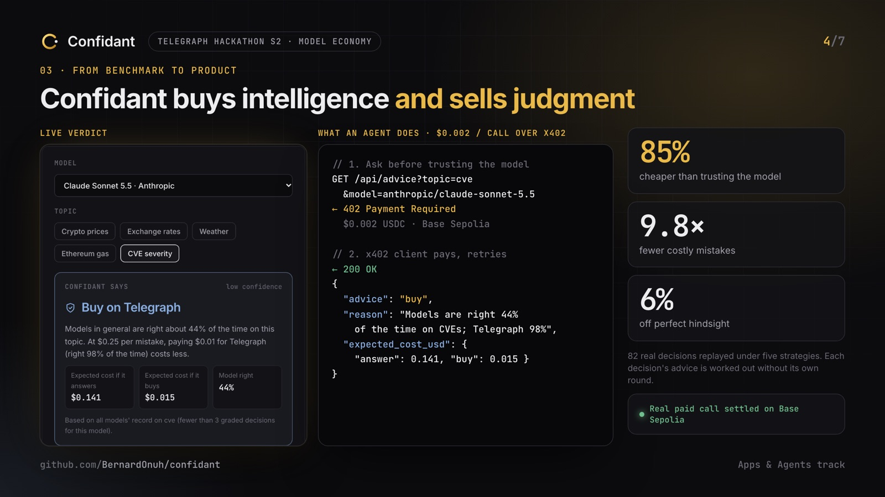
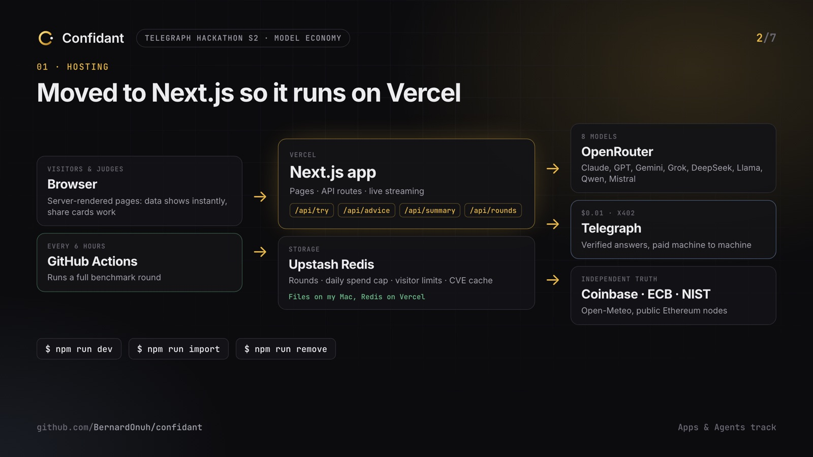

<div align="center">


### Which AI knows when it doesn't know?

**A live benchmark where AI models choose: trust their own memory for free, or pay [Telegraph](https://telegraphprotocol.com) $0.01 for a verified answer.**

[](https://confidant-seven.vercel.app)
[](https://hackathon.telegraphprotocol.com)
[](#how-a-purchase-works)
[](#host-it-on-vercel)
[](LICENSE)

**[Live site](https://confidant-seven.vercel.app)** · **[For judges](#for-judges)** · **[How it works](#how-it-works)** · **[Judgment API](#judgment-api-confidant-sells-what-it-learns)** · **[Run it](#run-it-on-your-computer)**

</div>

---



## The idea in 30 seconds

AI agents answer questions with money on the line. Every time, they face the same quiet choice: **trust the model, or pay for verified data?** Get it wrong one way and you waste money on data you didn't need. Get it wrong the other way and a confident wrong answer costs you far more.

Confidant turns that choice into a live contest. Eight models (Claude, GPT, Gemini, Grok, DeepSeek, Llama, Qwen, Mistral) get the same real-world questions, and for each one they decide:

| | Choice | Cost |
|---|---|---|
| 🧠 | **Answer from memory** | Free, but a wrong answer costs its principal **$0.25** |
| 🛒 | **Buy a verified answer on Telegraph** | About **$0.01**, a real machine-to-machine payment with x402 |

When every model has committed, Confidant fetches the truth from **independent sources** (Coinbase, the ECB, Open-Meteo, NIST and others) and grades everyone. The leaderboard ranks models by **judgment**: did they buy exactly when their own answer would have been wrong?

Then Confidant **sells what it learned**: any agent can pay $0.002 over x402 to ask "should model X trust itself on topic Y?" So it **buys** intelligence from Telegraph and **sells** judgment to agents: both sides of the model economy.

## How it works



## For judges

**Track:** Apps & Agents · **Mission:** 10, Model Economy · **Network:** Telegraph testnet, paid in test USDC on Base Sepolia (`eip155:84532`) with x402. Nothing here is mainnet or paying-customer usage.



### Try it in five steps

| Step | How |
|---|---|
| **Run it** with a new input | On the site, open **Try it**, pick a category and a subject (a coin, a city, a currency), or type any CVE ID. Every model decides to answer or buy, live. Or `POST /api/try` with `{ "category": "crypto", "subject": "SOL" }`. |
| **Check** the result | Each card shows every model's guess, whether it bought, the Telegraph answer, the independent truth and the grade. |
| **Inspect** the Telegraph purchase | Every buy stores its `signal_hash` and x402 receipt. Open `/receipts`, or check any hash at `https://devnode.telegraphprotocol.com/engine/v1/signal/<signal_hash>`. |
| **Break** it | Send a subject that isn't on the list: the API refuses it (400). Ask about a CVE ID that doesn't exist, e.g. `CVE-2026-99999`: the truth sources find nothing, so the question is **voided, not guessed**. Ask a 4th time in an hour on the hosted site: the rate limit refuses it (429). Set `DAILY_BUDGET_USD=0`: buying stops and models must answer alone. |
| **Reproduce** it | Follow [Run it on your computer](#run-it-on-your-computer): an OpenRouter key, a testnet wallet from `npm run wallet` and test USDC from the Circle faucet, then `npm run round`. |

### Evidence from the event (recorded rounds, 16 November 2026)

| | |
|---|---|
| Paid Telegraph purchases | **75** succeeded, 14 failed (recorded with the error, never retried silently) |
| Spend | **$0.75** test USDC, $0.01 per answer |
| Latency per purchase | median **7.4 s**, 90th percentile 10.5 s, including the x402 payment |
| Intents bought | `CRYPTO_PRICE_USD` 35 · `WEATHER_CHECK_TEMPERATURE` 16 · `GAS_PRICE_GENERAL` 9 · `CVE_LOOKUP_CVSS` 8 · `FX_NOW_EUR` 7 |
| Providers that answered | OnChain Intel Miner, Wx Openmeteo, Cp Coinbase, ChainSight, ExchangeRate-API v4 FX Now, Etherscan Gas Oracle v2 |
| Example purchase | signal `0x28a62b2baa9d133873b984b580d8199c9f611304ad12363c728f75d0b407b5c3`, receipt `0x08be9338c4bf0dd84edb5b6f32da9e27aa0ef51b316939a674e905f7610203ba` |
| Confidant selling over x402 | [Judgment API payment on Base Sepolia](https://sepolia.basescan.org/tx/0xe218749bddc712dcb7cbecc76f6630d491df71da43c7db972bb9852bca71725d) |

### Commercial summary

1. **Who is it for?** Teams running AI agents that answer questions with money or reputation at stake (support bots, trading and research agents, ops copilots). They face the same choice on every request: trust the model, or pay for verified data.
2. **What does it improve?** Today they guess, or pay for data on every call. Confidant measures, per model and per topic, when a model's own answer is right, so an agent buys only when it should. The leaderboard reports cost per correct answer and the true cost once mistakes are priced in, and it audits how often paid Telegraph answers were right.
3. **What does it do today?** Live rounds and visitor questions across eight models and five Intents, real x402 purchases from Telegraph testnet (above), independent grading with fallbacks, and the Judgment API, which sells "buy or answer?" advice for $0.002 over x402.
4. **Why would someone adopt it?** One cheap call before trusting a model saves both wasted data purchases and $0.25-style mistakes. Before production it needs mainnet Telegraph, more Intents and question types, more history per model and topic, and an SLA on the advice endpoint.
5. **How can someone try it?** On the live site (Try it, Leaderboard, Receipts, Developers), by calling `GET /api/advice/preview` free, or by running it locally from this README. Maintained by [@BernardOnuh](https://github.com/BernardOnuh).

## What it measures

| Metric | Meaning |
|---|---|
| Judgment | Bought when its own guess was wrong, answered when it was right |
| Accuracy | Final answers within tolerance, bought or not |
| Knew | How often its own guess was right, whatever it decided |
| Overconfident | Answered alone and got it wrong |
| Wasted buys | Paid for an answer it already had right |
| Cost / correct | Model tokens + Telegraph spend, per correct answer |
| True cost / question | All spend plus $0.25 per mistake, per question |

It also reports how often the **paid Telegraph answers** were correct, which makes it a running audit of the network.

## Questions and truth

Each round mixes live facts no model can remember with facts some models do:

| Category | Telegraph Intent | Truth source (independent of Telegraph) | Correct if |
|---|---|---|---|
| Crypto price | `CRYPTO_PRICE_USD` | Coinbase, then CoinGecko, then Kraken | within 1% |
| Exchange rate | `FX_NOW_EUR`, `FX_NOW_CAD`, `FX_NOW_SEK` | ExchangeRate-API, then Frankfurter (ECB) | within 1% |
| Temperature | `WEATHER_CHECK_TEMPERATURE` | Open-Meteo, then MET Norway | within 2.5 °C |
| Ethereum gas | `GAS_PRICE_GENERAL` | `eth_gasPrice` from public RPCs | within 35% or 0.3 gwei |
| CVE severity (famous) | `CVE_LOOKUP_CVSS` | NIST NVD | within 0.05 of any listed v3/v4 score |
| CVE severity (published in the last 20 days) | `CVE_LOOKUP_CVSS` | NIST NVD | same |

The truth for live data is fetched **after** every model has answered and bought. If no truth source answers, the question is voided, not guessed.

## Judgment API: Confidant sells what it learns

Every graded decision tells Confidant how often each model is right on each topic, and how often Telegraph is. Agents can buy that judgment before they trust a model:

```
GET /api/advice?model=anthropic/claude-sonnet-5.5&topic=crypto      → 402 Payment Required ($0.002 USDC, Base Sepolia)
```

Pay with any x402 client and retry; the reply says `"advice": "buy"` or `"answer"`, why, the expected cost of each choice, and how much history it rests on:

```js
const pay = wrapFetchWithPaymentFromConfig(fetch, { schemes: [{ network: "eip155:84532", client: new ExactEvmScheme(account) }] });
const { advice, reason } = await (await pay("https://<site>/api/advice?model=deepseek/deepseek-v4.1-flash&topic=cve")).json();
```

Payments are verified and settled by the x402 facilitator and only charged when the advice is delivered ([a real one](https://sepolia.basescan.org/tx/0xe218749bddc712dcb7cbecc76f6630d491df71da43c7db972bb9852bca71725d)). `GET /api/advice/preview` gives the same answer free, a few dozen times an hour, for the website. Topics: `crypto`, `fx`, `weather`, `gas`, `cve`.

So Confidant is both sides of the model economy: it **buys** intelligence from Telegraph miners and **sells** judgment to agents.



**What the advice is worth** (`GET /api/savings`): the real decisions replayed under five strategies (trust the model, the models' own choices, always buy, follow Confidant, perfect hindsight), priced at $0.01 per purchase and $0.25 per mistake. Confidant's advice for each decision is computed without that decision's round, so it never sees the answer.

## Run it on your computer

Needs Node 20.9 or newer.

```bash
npm install
cp .env.example .env            # add your OpenRouter key
npm run wallet                  # makes a throwaway testnet wallet, saves its key to .env, prints its address
```

Fund the wallet with test USDC (it is free):

- **Ethereum Sepolia** (default): get a little Sepolia ETH from a faucet for gas, then `npm run wallet -- mint` mints 10 test USDC.
- **Base Sepolia**: get USDC from the [Circle faucet](https://faucet.circle.com) and set `PAY_NETWORK=eip155:84532`.

10 USDC pays for 1,000 purchases. x402 payments themselves need no gas.

```bash
npm run check                   # checks the key, models, wallet, Telegraph's payment terms and storage; spends nothing
npm run round                   # one round in the terminal
npm run dev                     # the site on http://localhost:3000
```

Try it with no keys at all: `MOCK=1 npm run dev` uses three fake models and a fake miner.

On your computer rounds are JSON files in `data/rounds`.

## Host it on Vercel



The site is a Next.js app. On Vercel the rounds live in **Upstash Redis** (free tier), and scheduled rounds run from **GitHub Actions**, because Vercel functions can't run long jobs on a timer.

1. **Import the repo** at [vercel.com/new](https://vercel.com/new). Vercel detects Next.js; keep the defaults.
2. **Add storage:** in the project, open **Storage → Create Database → Upstash for Redis** (free), and connect it to the project. This adds `KV_REST_API_URL` and `KV_REST_API_TOKEN`.
3. **Environment variables** (Settings → Environment Variables): `OPENROUTER_API_KEY`, `EVM_PRIVATE_KEY` and `PAY_NETWORK` (same values as your `.env`). Optional: `NVD_API_KEY`, `TRY_PER_HOUR`, `DAILY_BUDGET_USD`.
4. **Redeploy** so the variables take effect.
5. **Scheduled rounds:** in GitHub, **Settings → Secrets and variables → Actions**, add the same `OPENROUTER_API_KEY`, `EVM_PRIVATE_KEY`, `PAY_NETWORK`, plus `KV_REST_API_URL` and `KV_REST_API_TOKEN` (copy them from Vercel's Upstash page). `.github/workflows/round.yml` then runs a round every 6 hours. Run one now from **Actions → Scheduled round → Run workflow**.
6. **Bring over past rounds** (optional): put the two `KV_` values in your `.env` and run `npm run import`. `npm run remove -- <round id>` deletes a round that went wrong.

The **Try it** box runs on Vercel itself: one question, every model, in up to 5 minutes (`maxDuration` in `app/api/try/route.js`). One visitor question runs at a time, and each visitor gets `TRY_PER_HOUR` (3) per hour.

## How a purchase works

```js
const pay = wrapFetchWithPaymentFromConfig(fetch, { schemes: [{ network, client: new ExactEvmScheme(account) }], spendControls: { ... } });
const res = await pay("https://devnode.telegraphprotocol.com/engine/v1/ask", {
  method: "POST", body: JSON.stringify({ intent: "CRYPTO_PRICE_USD", params: { symbol: "BTC" } }),
});
// → { result: { price_usd: ... }, cost_usd: 0.01, signal_hash: "0x…", miner_id: "…" }
```

The node answers `402 Payment Required`, the x402 client signs a USDC transfer authorisation, and the request is retried and paid. Every purchase is stored with its `signal_hash`, which anyone can verify at `GET /engine/v1/signal/{hash}`. See `src/telegraph.mjs`.

## Safety

- The wallet is a throwaway testnet key, kept only in `.env` (git-ignored) and never printed.
- Each purchase is capped (`MAX_PRICE_PER_CALL`, default $0.05), and buying stops for the day at `DAILY_BUDGET_USD` (default $5).
- Questions sent to Telegraph are public on its Daemon feed; Confidant only asks about public facts.
- Visitors can ask 3 questions an hour, one at a time.

## Limitations

- Results depend on the prompt; every model gets the identical prompt (`src/models.mjs`), shown in the source so anyone can challenge it.
- Live values move: truth is fetched seconds after the models answer, and tolerances allow for that.
- CVSS has several versions; any score NVD lists for the CVE counts.
- Runs on Telegraph **testnet**. Purchases are real x402 payments in test USDC, not mainnet funds.

<details>
<summary><b>Project layout and API routes</b></summary>

```
src/questions.mjs   categories, Intents, prompts, tolerances
src/truth.mjs       independent truth sources with fallbacks
src/models.mjs      the prompt and the OpenRouter call
src/telegraph.mjs   x402 purchases from Telegraph
src/grade.mjs       grading and the leaderboard (tested)
src/round.mjs       one round, end to end
src/store.mjs       rounds, leaderboard and daily spend
src/kv.mjs          storage: files on a laptop, Upstash Redis when hosted
src/api.mjs         what each API endpoint does
src/advice.mjs      the advice and the strategy replay (tested)
lib/x402.js         selling the advice over x402
src/cli.mjs         round, check, wallet, import, remove
app/                the Next.js site: / (home), /leaderboard, /savings, /try, /developers, /receipts,
                    /rounds, /rounds/<id>, /method; and the API routes in app/api/*
components/         the page's parts: leaderboard, try box, rounds, question cards
.github/workflows/  the scheduled round
```

API: `GET /api/advice` (paid, x402), `GET /api/advice/preview`, `GET /api/savings`, `GET /api/showcase`, `GET /api/summary`, `GET /api/rounds?limit=20`, `GET /api/rounds/<id>`, `GET /api/options`, `GET /api/health`, `POST /api/try` with `{ "category": "crypto", "subject": "BTC" }`.

</details>

## Credits

Built on [Telegraph](https://telegraphprotocol.com) (testnet intelligence network), [x402](https://x402.org) payments, [OpenRouter](https://openrouter.ai) for the eight contestant models, [Next.js](https://nextjs.org) on [Vercel](https://vercel.com), [Upstash Redis](https://upstash.com), and independent truth from Coinbase, CoinGecko, Kraken, ExchangeRate-API, Frankfurter (ECB), Open-Meteo, MET Norway, public Ethereum RPCs and NIST NVD.

## Licence

[MIT](LICENSE)

<div align="center"><br><br><sub>Know when you don't know.</sub></div>
